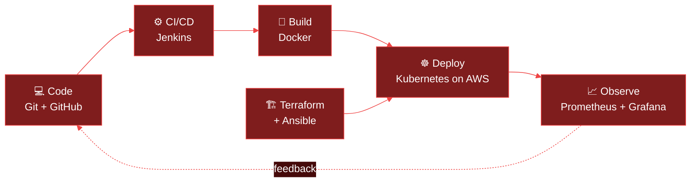

<!-- Header banner -->

  

👋 About Me
I'm working toward becoming an AWS DevOps Engineer, pairing solid theory with hands-on project work. I enjoy turning manual, error-prone infrastructure tasks into reliable, automated, observable systems, and I'm looking for opportunities to contribute innovative solutions to cloud infrastructure and automation.
	
🔭 Focus	AWS, containers, Kubernetes, CI/CD, Infrastructure as Code
🌱 Learning	Production-grade pipelines, cluster operations, monitoring and alerting
📝 Writing	Regular articles on Hashnode
💬 Ask me about	AWS, Docker, Jenkins, Linux, Shell Scripting, GitHub, Ansible, Terraform, Kubernetes, Grafana, Prometheus
📫 Reach me	papanihal360@gmail.com
⚡ Fun fact	I ᐃM ᐃWESOME 💀

🔄 How I Like to Ship

🛠️ Tech Stack
☁️ Cloud & Infrastructure

📦 Containers & CI/CD

📈 Monitoring & Observability

🗄️ Databases

🧰 Other tools I've used

Also: Apache Hive · IFTTT · Zapier

🚀 Featured Projects
<!--
  Replace REPO-NAME-1 to REPO-NAME-4 below with your real repo names.
  The cards update automatically from each repo's stats.

> 💡 All my projects live at **[github.com/NIHALPAPA](https://github.com/NIHALPAPA)**.

📊 GitHub Stats

✍️ Latest Articles
I write about DevOps and cloud topics on Hashnode. Read more at hashnode.com/@NIHALPAPA.
<!--
  Optional: auto-update the list below with a GitHub Action such as
  gautamkrishnar/blog-post-workflow, using your Hashnode RSS feed.
<!-- BLOG-POST-LIST:START -->
<!-- BLOG-POST-LIST:END -->

🌐 Connect With Me

  

 

